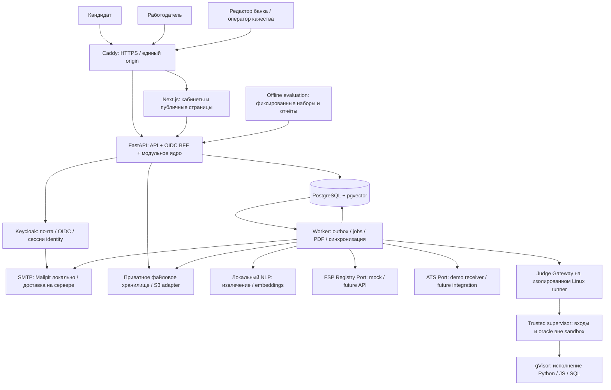

# 2. Архитектура проекта

## 2.1. Основное решение

**Модульное прикладное ядро с отдельными процессами фоновой работы, ML и проверки пользовательского кода.** Границы строятся вокруг предметных областей и доверия. Самые опасные и ресурсоёмкие операции изолируются; обычные транзакции профиля, категории и приглашения остаются простыми и атомарными.

Это современная архитектура с типизированными контрактами, OIDC, событийными обновлениями, контролем происхождения данных и независимым масштабированием тяжёлых задач. Для первого запуска она не требует Kubernetes, Kafka, отдельной графовой БД или десятка CRUD-микросервисов. Разделение API на независимые сервисы возможно по измеренной необходимости, без изменения пользовательской модели.

Архитектурные принципы:

- Правила категории и контактных разрешений применяет сервер.
- Модель данных отличает заявления от доказательств.
- Критичные операции проходят транзакции; события публикуются после фиксации через outbox.
- Фоновые задачи допускают повторную доставку и выполняются идемпотентно.
- Данные конкретной компании и кандидата доступны только соответствующим участникам.
- Любой балл можно воспроизвести по версиям входных данных и алгоритма.
- Отказ ML, ФСП или доставки письма имеет понятное состояние и не подменяет успех.
- Пользовательский код никогда не исполняется в API, worker или контейнере с БД.

## 2.2. Компонентная схема



Диаграмма показывает зависимости, а не обязательное количество серверов. В локальном стенде обычные процессы находятся в Compose; judge работает в выделенном Linux-контуре с настроенным runtime. Offline evaluation не имеет права изменять результаты обычных пользователей.

## 2.3. Стек и правила фиксации версий

| Слой | Рекомендуемая технология | Причина выбора |
|---|---|---|
| Web runtime | Node.js 24 LTS | Поддерживаемая LTS-ветка для запуска и сборки |
| Frontend | Next.js 16.4, React 19.3, TypeScript | Современный UI, маршрутизация, публичные страницы и кабинеты |
| UI | Tailwind CSS 4, Radix/shadcn-компоненты, Lucide | Доступные интерактивные элементы и быстрый единый дизайн |
| Данные на клиенте | TanStack Query, React Hook Form, Zod | Кэш запросов с разделением пользователей, формы и явная валидация |
| API | FastAPI, Pydantic 2 | Типизированная предметная модель и OpenAPI |
| Python | 3.14 для ядра, ML-образ на совместимой поддерживаемой версии | ML-зависимости проверяются отдельной сборкой; единая версия не навязывается всем образам |
| БД | PostgreSQL 18, pgvector 0.8.7 | Транзакции, фильтрация и поиск в одном хранилище |
| ORM / миграции | SQLAlchemy 2 + asyncpg, Alembic | Явные транзакции, схема и воспроизводимые изменения |
| Identity | Keycloak, OIDC Authorization Code + PKCE | Готовая email-верификация и совместимость с будущим ФСП ID |
| Фоновые задачи | Durable jobs и outbox в PostgreSQL | Локальный запуск без обязательного дополнительного брокера |
| Event broker при росте | NATS JetStream | Небольшой отдельный контур доставки, подтверждения и redelivery |
| Resume / PDF | pypdf или pdfplumber; ReportLab для экспорта | Локальный разбор и предсказуемый PDF с встроенным шрифтом |
| NLP | sentence-transformers, multilingual-e5-small; rules/словарь | Работает на CPU, не требует LLM API для основного пути |
| Judge | gVisor/runsc + собственный supervisor; OCI-образы языков | Сильнее изоляция исполнения и независимое хранение oracle |
| Наблюдаемость | OpenTelemetry, JSON logs; Prometheus/Grafana отдельным профилем | Метрики и причинная связь запросов без утечки содержимого профилей |
| Проверки | pytest, Hypothesis, Playwright, k6, Ruff, mypy/pyright, ESLint | Предметные, сквозные и нагрузочные проверки |
| Развёртывание | Docker Compose, Caddy, Linux / WSL2 | Повторяемый запуск, единый origin и HTTPS при публикации |

На 7 октября официальная публикация подтверждает [Next.js 16.4 и React 19.3](https://nextjs.org/blog/next-16-4); [Node.js 24 обозначен LTS](https://nodejs.org/en/about/previous-releases), [Python 3.14 — bugfix-веткой](https://www.python.org/downloads/), документация PostgreSQL — [веткой 18](https://www.postgresql.org/docs/current/release.html), pgvector — [0.8.7](https://github.com/pgvector/pgvector). Это не проверка совместимости нашего ещё не созданного проекта.

Перед первым scaffold фиксируются точные версии всех зависимостей и образов: `pnpm-lock.yaml`, `uv.lock`, container digest и `model-manifest.json`. Если новый релиз не проходит smoke, выбирается поддерживаемая стабильная совместимая версия и решение записывается в ADR. В release не используются `latest`, свободные диапазоны версий или незакреплённый model revision.

Лицензии runtime, моделей, шрифтов и UI проверяются отдельно. Исходный код проекта — Apache-2.0 либо MIT. Сторонний публичный код без лицензии не включается в проект автоматически.

## 2.4. Предметные модули ядра

| Модуль | Владеет | Не должен делать |
|---|---|---|
| Identity & Access | Связь local account ↔ issuer/subject, сессии, роли, членство в компании | Присваивать грейд по OAuth claim |
| Candidate Profile | Резюме, настройки поиска, контакты и согласия | Выдавать заявленный навык за проверенный |
| Taxonomy | Отрасли, специализации, грейды, навыки, competency map | Менять смысл старых результатов без версии |
| Assessment | Blueprint, формы, попытки, ответы, правила подтверждения | Применять score от свободного LLM без рубрики |
| Evidence & Passport | Подтверждения, происхождение, свежесть и проекции паспорта | Открывать сырые ответы всем работодателям |
| FSP Integration | Привязка identity, достижения, статусы источника, синхронизация | Считать вручную введённый ID доказательством владения |
| Employer Needs | Профиль компании, потребности, требуемые условия | Менять начатые попытки при редактировании вакансии |
| Matching & Search | Допуск, признаки, ранжирование, объяснения, сохранённые выдачи | Использовать контакты, пол или возраст для score |
| Hiring & Contact Grants | Приглашения, статусы, раскрытие, отзыв, блокировка | Открывать контакты всем компаниям после одного accepted |
| Vacancies & Applications | Публикации, самостоятельные отклики и статусы | Подменять основной сценарий обратного найма |
| Microchallenges | Короткие задачи, назначения, решения и отдельные evidence | Менять грейд только по оценке одного работодателя |
| Files & Export | Приватные файлы, импорт, экспорт PDF | Отдавать исходное резюме до разрешения |
| Quality & Moderation | Качество банка, жалобы, аудит, ограниченные действия оператора | Исправлять результат без журнала и причины |
| Notifications & Integrations | Письма, внутренняя лента, ATS и фоновые события | Держать единственную копию важных событий в памяти |

Модули экспортируют application-сервисы и DTO. Обращение к чужой таблице напрямую запрещается архитектурным правилом, кроме специально документированных read models. Сложные вычисления — чистые функции; инфраструктура подключается через ports/adapters.

## 2.5. Структура репозитория

```text
apps/
  web/                     Next.js, страницы и features
services/
  api/                     FastAPI entrypoint, composition root
  worker/                  jobs/outbox handlers
  ml/                      NLP runtime, model cache, health
  judge/                   gateway/supervisor, отдельный runner
  fsp-mock/                демонстрационный контракт реестра
  ats-mock/                демонстрационный получатель
packages/
  domain/                  модели и чистые правила Python
  application/             use cases и ports
  infrastructure/          PostgreSQL/OIDC/files/mail adapters
  api-client/              генерируемый TS-клиент OpenAPI
  ui/                      токены и общие React-компоненты
data/
  schemas/                 JSON Schema всех наборов
  synthetic/               seed и вымышленные персоны
  benchmark/               зафиксированные public benchmark
assessment-bank/
  taxonomy/
  blueprints/
  families/                генераторы и эталонные решения
  rubrics/
evaluation/
  datasets/
  baselines/
  experiments/
  reports/
deploy/
  compose.yaml
  profiles/                demo, ml, observability, runner
  keycloak/                realm import, mail config
  caddy/
  runner/
scripts/                   setup.ps1, setup.sh, doctor, verify, evaluate
docs/                      architecture, ADR, OpenAPI, mechanics, runbook
```

Это целевая структура. Не создавать пустой пакет ради строки в дереве: небольшие Python packages могут находиться в одном workspace, пока сохраняются границы зависимостей. CI запрещает circular imports и ручные расхождения TS-схем с OpenAPI.

## 2.6. Модель данных

UUID идентификаторы, UTC timestamps, версия строки для optimistic concurrency. Деньги хранятся целыми рублями; валюта RUB. Даты в интерфейсе локализуются, дедлайн сдачи отображается в МСК.

| Группа | Основные таблицы и поля |
|---|---|
| Identity | `accounts`, `external_identities(issuer, subject)`, `sessions`, `company_memberships` |
| Приватные данные | `candidate_contacts(candidate_id, encrypted_payload)`, `consents(purpose, text_version, granted_at, revoked_at)` |
| Профиль | `candidate_profiles`, `resume_versions`, `candidate_preferences`, `profile_visibility` |
| Таксономия | `specializations`, `grades`, `skills`, `competencies`, `skill_edges`, `taxonomy_versions` |
| Банк | `task_families`, `family_versions`, `assessment_blueprints`, `rubric_versions`, `item_statistics` |
| Экзамен | `assessment_attempts`, `attempt_items`, `attempt_answers`, `judge_submissions`, `scoring_results` |
| Категория | `candidate_categories(candidate_id, specialization_id, grade_id, confirmed_by_attempt_id, confirmed_at, next_change_at)` |
| Доказательства | `skill_evidence(skill_id, kind, source_ref, score, measured_at, validity_state)`, `passport_versions` |
| ФСП | `fsp_links`, `fsp_sync_runs`, `achievements`, `achievement_source_records`, `revoked_achievements` |
| Работодатель | `companies`, `employer_needs`, `need_versions`, `need_skills`, `vacancies`, `vacancy_versions` |
| Подбор | `match_runs`, `match_run_candidates`, `match_explanations`, `saved_searches` |
| Взаимодействие | `invitations`, `invitation_terms_versions`, `invitation_events`, `contact_grants`, `applications` |
| Практика | `microchallenges`, `challenge_assignments`, `challenge_submissions`, `challenge_results` |
| Инфраструктура | `file_objects`, `jobs`, `outbox_events`, `processed_events`, `notification_deliveries`, `audit_events` |

Ключевые ограничения БД:

- `UNIQUE(issuer, subject)` для внешней identity.
- Одна активная категория на специализацию кандидата; one-primary-specialization в интерфейсе первой версии. Несколько подтверждённых специализаций — поддерживаемое расширение, не перенос одного грейда на все роли.
- Один активный экзамен кандидата; частичный UNIQUE по активным статусам.
- Каждая форма закреплена за неизменяемыми версиями blueprint, семейства и рубрики.
- `CHECK(salary_from > 0 AND salary_to >= salary_from AND currency = 'RUB')` для публикуемой вакансии и отправляемого приглашения. Черновик вакансии может быть неполным.
- У приглашения обязательны company, candidate, terms и контакт работодателя; `vacancy_id` nullable.
- Один активный contact grant на компанию/кандидата/область разрешения; ссылка на accepted invitation либо application.
- Грант не является полем `contacts_public=true` у кандидата.
- UNIQUE source event/id/version для предотвращения дублей ФСП.
- UNIQUE idempotency scope/key для создания приглашения, сдачи попытки и отправки ATS-события.

Жизненные циклы описываются enum + application state machine, а не свободной строкой. Значимые проверки одновременно существуют в домене и БД; ошибки ограничений преобразуются в понятный API-ответ.

## 2.7. Транзакции и события

**Подтверждение категории:** закрыть принятую попытку → сохранить неизменяемый результат → обновить категорию по policy → записать evidence → записать outbox event. Всё в одной транзакции. Фоновая перестройка поисковой проекции не является условием успешной сдачи.

**Принятие приглашения:** проверить адресата, отправителя, состояние, срок и текущую версию условий → CAS-обновление статуса → создать scoped grant → журнал согласия → outbox. Повтор возвращает согласованный прежний результат, без дублирования гранта.

**Отзыв согласия:** отозвать publication/grants в транзакции, повысить visibility version, записать событие очистки производных проекций. Любое последующее чтение проверяет актуальные права, поэтому очередь удаления не создаёт окно доступа.

Основные события: `EmailVerified`, `ProfilePublished`, `AssessmentCompleted`, `CategoryConfirmed`, `FSPSyncCompleted`, `EvidenceChanged`, `InvitationSent`, `InvitationViewed`, `InvitationAccepted`, `ContactGrantRevoked`, `ConsentRevoked`, `ChallengeCompleted`, `ATSExportRequested`.

Outbox dispatcher выбирает строки через `FOR UPDATE SKIP LOCKED`; job имеет lease, счётчик попыток, backoff и dead-letter state. Обработчик фиксирует effect и `processed_event` идемпотентно. Гарантия доставки — **at least once**, поэтому «ровно один раз» не обещается. Если эффект внешний, применяется idempotency key провайдера либо локальный ledger повторов.

Брокер NATS включается, когда появятся несколько независимо развёрнутых потребителей или измеренная необходимость. Его [pull consumers и explicit ack](https://docs.nats.io/learn/jetstream/pull-consumers) вписываются в тот же контракт событий. Broker ack не заменяет запись бизнес-эффекта.

## 2.8. API

API prefix `/api/v1`. JSON DTO, RFC 9457 Problem Details, request ID, cursor pagination, `Idempotency-Key`, optimistic version/ETag там, где возможно конкурентное изменение. OpenAPI генерируется из backend и проходит contract check.

| Контур | Эндпоинты первой версии |
|---|---|
| Auth BFF | `GET /auth/login`, `GET /auth/register`, `GET /auth/callback`, `POST /auth/logout`, `GET /me` |
| Справочники | `GET /taxonomy`, `/specializations`, `/skills`, `/assessment-capabilities` |
| Профиль | `GET/PATCH /candidate/profile`, `PUT /candidate/preferences`, `POST /candidate/resume-imports`, `GET /candidate/resume-imports/{id}` |
| Согласия | `GET /candidate/consents`, `POST /candidate/consents/{purpose}/grant`, `/revoke` |
| Опрос | `PUT /candidate/survey`, `GET /candidate/survey-history` |
| Экзамен | `POST /candidate/attempts`, `GET /candidate/attempts/{id}`, `PUT /candidate/attempts/{id}/answers/{item}`, `POST /candidate/attempts/{id}/submit` |
| Код | `POST /candidate/attempts/{id}/submissions`, `GET /candidate/submissions/{id}` |
| Результат | `GET /candidate/categories`, `/assessment-history`, `/passport`, `/passport.pdf` |
| ФСП | `GET /candidate/fsp`, `POST /candidate/fsp/link/start`, `GET /candidate/fsp/link/callback`, `POST /candidate/fsp/sync`, `DELETE /candidate/fsp/link` |
| Компания | `GET/PATCH /employer/company`, `GET/POST /employer/needs`, `PATCH /employer/needs/{id}`, `POST /employer/needs/analyze` |
| Подбор | `GET /employer/categories`, `POST /employer/needs/{id}/matches`, `GET /employer/match-runs/{id}`, `POST /employer/match-runs/{id}/refine` |
| Банк | `GET /employer/candidates`, `GET /employer/candidates/{id}`, `POST /employer/needs/{id}/compare` |
| Приглашения | `POST /employer/invitations`, `GET /employer/invitations`, `POST /employer/invitations/{id}/withdraw` |
| Ответ кандидата | `GET /candidate/invitations`, `POST /candidate/invitations/{id}/view`, `/accept`, `/decline`, `/clarify` |
| Контакты | `GET /employer/candidates/{id}/contacts`, `POST /candidate/contact-grants/{id}/revoke` |
| Вакансии | `GET /vacancies`, `GET/POST /employer/vacancies`, `POST /employer/vacancies/{id}/publish` |
| Отклики | `POST /candidate/applications`, `GET /candidate/applications`, `GET /employer/applications`, `POST /employer/applications/{id}/transition` |
| Практика | `GET /candidate/challenges`, `POST /candidate/challenges/{id}/submit`, `GET/POST /employer/challenges` |
| События | `GET /notifications`, `GET /events` (SSE), `POST /notifications/{id}/read` |
| Качество | `GET /admin/quality`, `POST /admin/families/{id}/suspend`, `GET /admin/audit` |
| ATS | `POST /employer/ats-connections`, `POST /employer/invitations/{id}/export` |
| Эксплуатация | `GET /health/live`, `/health/ready`, закрытый `/metrics` |

Пример приглашения:

```json
{
  "candidate_id": "uuid",
  "need_id": "uuid",
  "vacancy_id": null,
  "description": "Разработка сервисов командного планирования",
  "salary_from": 180000,
  "salary_to": 240000,
  "currency": "RUB",
  "period": "month",
  "tax_basis": "gross",
  "work_format": "remote",
  "company_contact": "hr@example.test",
  "terms_version": 1
}
```

`gross/net`, период, тип занятости и этап общения — дополнительные полезные условия; диапазон в рублях остаётся обязательным требованием ТЗ. Необязательно оплаченный бонус/акции показываются отдельно от основного диапазона.

## 2.9. Identity и права

Keycloak обеспечивает регистрацию и подтверждение email. Прикладной BFF в FastAPI принимает OIDC callback, проверяет state, nonce, PKCE, issuer, audience и сроки. Сервер хранит токены провайдера в защищённом хранилище; браузер получает непрозрачную HttpOnly session-cookie. Поддерживаемые протоколы описаны в [документации Keycloak](https://www.keycloak.org/securing-apps/oidc-layers).

В production cookie имеет Secure и SameSite; unsafe-запросы защищены CSRF-token и проверкой Origin. Для HTTP localhost разрешено явно обозначенное dev-исключение Secure. OIDC-адреса realm и callback согласованы с hostname из браузера, а не только с именем контейнера.

Self-selection роли создаёт профиль кандидата либо работодателя, но не выдаёт административные полномочия. Доступ компании определяется актуальным membership в БД; нельзя доверять одному `company_id` из браузера. IDP claims подтверждают identity, а не профессиональную категорию.

| Объект | Кандидат | Работодатель | Оператор |
|---|---|---|---|
| Свой профиль/контакты | Читать/менять | Нет | Ограниченный support access с аудитом |
| Другой кандидат | Нет | Только опубликованная безопасная проекция | По служебной цели и разрешению |
| Сырые ответы экзамена | Только собственная разрешённая обратная связь | Нет | Авторизованный редактор качества |
| Категория | Собственная | Опубликованная категория | По scope |
| Приглашение | Только адресованные ему | Только своей компании | Ограниченно по жалобе |
| Контакты кандидата | Собственные | Только при активном grant своей компании | Не входят в обычный экран качества |
| Потребность компании | Нет | Только своей компании | По scope |
| Демонстрационный benchmark | Синтетическая публичная проекция | Синтетическая публичная проекция | Управление версиями |

API использует ownership check и ABAC, а не только `role=employer`. PostgreSQL RLS служит дополнительной защитой выбранных таблиц: application-role без BYPASSRLS, ограничения owner, корректный transaction-local context. Worker имеет отдельные ограниченные права. RLS не заменяет безопасный DTO и тесты прямого чтения/экспорта. [Официальная модель RLS](https://www.postgresql.org/docs/current/ddl-rowsecurity.html).

## 2.10. Приватность и безопасные проекции

До принятия работодатель получает candidate alias, подтверждённую категорию, согласованные компетенции, свежесть, условия поиска и разрешённые агрегаты ФСП. Контактные поля отсутствуют в ответе. Исходный PDF не доступен; вместо него есть отдельный редактированный export. JSON нельзя сначала отправить полностью и затем скрыть поля React-компонентом.

Публичный profile text строится из allowlist структурированных полей. Текст резюме, ссылки на GitHub, protocol URL ФСП, фотографии и исходные документы могут раскрывать личность; они проходят отдельное разрешение и не попадают автоматически в закрытую карточку. Здесь применяется псевдонимизация, а не обещание необратимой анонимности.

Privileged ответы и SSR — `Cache-Control: private, no-store`; персональные запросы не помещаются в общий Next.js cache. Клиентский кэш очищается при logout/смене аккаунта. Saved match run содержит score snapshot, но перед каждым чтением rechecks публикации и grants. Векторы строятся по безопасной проекции без контактов.

Согласие на обработку оформляется отдельно; публикация и передача контактов имеют разные цели и события. Пользователь видит состояние и может отозвать разрешение. Техническая реализация должна поддерживать требования к конкретному и подтверждаемому согласию, отражённые в [152-ФЗ на сайте Минтруда](https://mintrud.gov.ru/docs/laws/130). Применение Docker, шифрования и checkbox само по себе не является подтверждением полного правового соответствия.

При работе с реальными данными планируются российское первичное хранение, согласованные сроки retention, удаление файлов и производных проекций, ограничение персональных логов, учёт целей доступа. Точный режим обработки и документы оператора проверяются перед реальным запуском. На конкурсном стенде по умолчанию используются вымышленные данные.

## 2.11. Изоляция исполнения

Runner работает на выделенном Linux-хосте/VM, с gVisor runtime и собственным узким gateway. БД и identity-провайдер недоступны из его execution network; контейнер решения не имеет Docker socket, внешней сети, root capabilities или host mounts.

Trusted supervisor передаёт вход в sandbox, забирает ответ и сравнивает с oracle **снаружи**. Скрытые эталоны и секреты не монтируются в окружение пользовательской программы. Разрешённые файлы — только submission, фиксированный runtime и временный каталог. Общие папки между попытками запрещены.

Предварительные лимиты: 1 CPU, 256–512 MiB RAM, process count, ограниченный stdout, wall timeout и общий бюджет попытки. Точные значения определяются задачей и проверяются нагрузкой. Для компиляции лимиты могут быть другими, чем для исполнения. Trusted task generators проходят отдельную проверку и не принимают произвольный код работодателя.

[gVisor](https://gvisor.dev/docs/) добавляет слой изоляции, но требует проверки совместимости и конфигурации. Обычный Docker с общим ядром не считается достаточным аргументом безопасного публичного исполнения.

На Windows: Docker Desktop/WSL2 для обычного стека; runner — документированный Linux VM/WSL-контур с проверенным `runsc`. Включение code-execution проходит `doctor` и security smoke. При неподдерживаемом окружении code-execution fail-closed; MCQ/структурные задачи продолжают работать, а ограничение явно отражается в readiness. Полный конкурсный стенд должен заранее пройти профиль runner.

## 2.12. Локальный запуск и ресурсы

Цель — единая команда запуска после первоначальной настройки Docker/WSL2. Первый build может требовать интернет для образов и модели; дальнейший offline-запуск возможен только после подготовки cache/архива образов. Нельзя называть первую сборку полностью автономной.

| Профиль | Состав | Предварительный ресурсный бюджет |
|---|---|---|
| `core` | proxy, web, api, worker, PostgreSQL, Keycloak, Mailpit, fsp-mock | Контейнерам ориентировочно 4–6 GiB RAM; измерить на реальной машине |
| `ml` | Локальное извлечение и embeddings | Ещё 1–2 GiB; зависит от выбранного runtime/model |
| `runner` | Judge и ограниченная конкуренция sandbox | Ещё 1–3 GiB; максимальная очередь ограничена |
| `observability` | Collector, Prometheus, Grafana | Дополнительный бюджет, не обязателен для проверки жюри |

Для разработки рекомендуется машина с 16 GiB RAM; это бюджет, не измеренный факт. Полный профиль не обязан работать в заданной RAM, пока не проведена проверка. Если не укладывается, оптимизируются concurrency, runtime и необязательные процессы, а метрики стенда публикуются.

`setup.ps1`/`setup.sh` создают случайные dev secrets, проверяют порты и Docker, готовят `.env`, собирают pinned образы, выполняют миграции и загружают synthetic seed. Они не включают внешние API ключи. `doctor` проверяет readiness БД, IDP, SMTP, ФСП, ML и runner отдельно. Mailpit доступен только локально; нельзя выставить общий почтовый ящик реального стенда в интернет.

Один core origin: `http://localhost:8080`. Документируются адреса локальной почты, Swagger и Identity; настройки перенаправлений корректно работают из браузера. Демо-аккаунты и ускоренное демо-время существуют только в явном demo profile.

## 2.13. Наблюдаемость и масштабирование

Измеряются latency API/подбора, DB query time, queue depth/age, judge duration, error rate, OIDC/SMTP/FSP failures, время отзыва grants, CPU/RAM. Logs содержат request ID, actor pseudonymous ID и action, без паролей, токенов, контактов и текста резюме. Trace связывает запрос с worker и submission. OpenTelemetry — стандартный интерфейс телеметрии; backend можно менять отдельно. [Документация Python](https://opentelemetry.io/docs/languages/python/).

Производительность: на MVP категории и search projection индексированы; пагинация выполняется после корректного ранжирования всего допущенного множества. На малом наборе vector exact search предсказуемее; HNSW включается после проверки recall и фильтрации. Отдельная векторная БД потребуется только при измеренной необходимости.

План развития: увеличить worker/runner concurrency → вынести read model поиска → выделить NLP runtime → добавить NATS → выделить доменный сервис Assessment при отдельной нагрузке/команде. Kubernetes и managed DB рассматриваются по SLO и эксплуатации. Их отсутствие в первом релизе не мешает современной архитектуре.

Перед публикацией: backup и тест восстановления, HTTPS, отдельные production secrets, запрет demo shortcuts, миграции one-shot, ограниченные сетевые порты, реальные SMTP delivery и monitoring. Наличие локального стенда не автоматически создаёт публичный URL: для него потребуется хостинг либо согласованная доступная среда.
