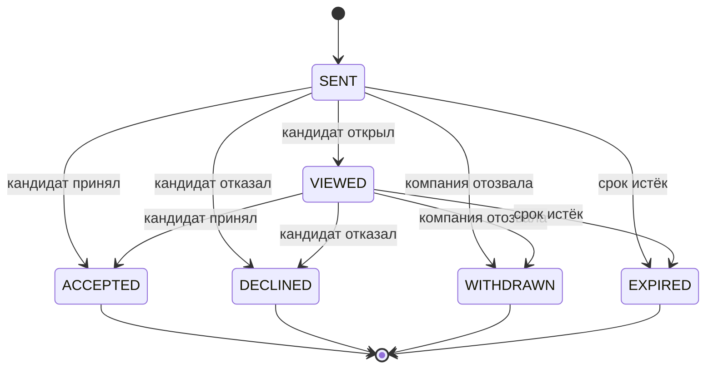

# 3. Продуктовые механики

## 3.1. Паспорт подтверждённых компетенций

Паспорт — центральный объект продукта. Он отвечает на вопросы: что кандидат заявил; что система проверила; в каких условиях; когда; что подтверждено ФСП; какие выводы пока делать нельзя.

| Тип | Пример | Как показывать |
|---|---|---|
| `SELF_DECLARED` | «React, 3 года опыта» | Заявлено кандидатом, не участвует как подтверждённая компетенция |
| `ASSESSMENT_VERIFIED` | SQL transactions: проверка в экзамене backend/middle | Дата, рубрика, число наблюдений и источник подтверждения |
| `PRACTICE_OBSERVED` | Недавно решена задача работодателя | Свежая практика; отдельный ограниченный сигнал |
| `FSP_DEMO_CONFIRMED` | Синтетический результат демо-реестра | Явно «демонстрационные данные», без обещания настоящей верификации |
| `FSP_REGISTRY_VERIFIED` | Результат будущего официального реестра | Источник, статус, дата синхронизации, событие/протокол |
| `STALE` / `REVOKED` | Устаревшее подтверждение или отзыв источником | Не маскировать под действующее; показать причину и историю |

Паспорт не является государственным документом или гарантией найма. Экзамен подтверждает ограниченный набор знаний и практических действий в указанных условиях. Ответственность за дальнейшее решение о найме остаётся у работодателя.

Работодатель видит безопасную проекцию: alias, специализация, грейд, проверенные компетенции, результаты в контексте категории, дата, допустимые достижения ФСП, предпочтения и пробелы относительно потребности. Кандидат видит более подробную собственную историю и следующий шаг.

Версия паспорта связывается с версиями категории, taxonomies, rubrics, score policy и evidence. Изменение резюме не переписывает прошлые результаты.

## 3.2. Категории и справочники

Категория = **specialization × confirmed grade**. Отрасль/контекст работы — дополнительные поля поиска. Стек — уточнение специализации и область evidence; он не заменяет грейд.

Первая версия справочника:

| Направление | Компетенции | Поддерживаемые практические контексты |
|---|---|---|
| Backend | Язык/структуры, API, БД, надёжность, тестирование | Python и JavaScript/TypeScript как отдельные маршруты банка |
| Frontend | JS/TS, DOM/React, состояние, доступность, производительность | React + браузерные сценарии |
| QA | Test design, API testing, SQL, автоматизация, анализ дефектов | Python/JS automation либо структурные проверки |
| DevOps/SRE | Linux, контейнеры, сети, диагностика, отказоустойчивость | Ограниченная симуляция и конфигурационные сценарии |
| Data analytics | SQL, статистика, Python, интерпретация, качество данных | Синтетические таблицы и небольшие наборы |
| Security/CTF | Анализ уязвимостей, web security, безопасный код, triage | Только изолированные вымышленные учебные сценарии |

Грейды: Intern/Trainee, Junior, Middle, Senior. Роли Lead/Architect отражают вид ответственности и заявленный опыт; короткий тест не подтверждает сам факт руководства. Поднаправления и competency map имеют версию.

Выбор кандидатом стека определяет доступный проверочный маршрут. Для одного подтверждения `Backend × Middle` должна быть обозначена область — например, Python/SQL/API. Грейд не должен автоматически считаться доказательством знания Java или Kafka. В подборе проверяется конкретное evidence.

## 3.3. Путь кандидата

1. Создаёт аккаунт, подтверждает email, даёт отдельное согласие на обработку.
2. Заполняет структурированную форму либо импортирует резюме. Импортированные значения становятся черновиком с исходными цитатами.
3. Выбирает предпочтения: занятость, формат, зарплатный диапазон, готовность к предложениям, ограничения компаний.
4. Проходит опрос: специализация, отрасль/контекст, стек, предполагаемый грейд.
5. Получает понятный план теста: длительность, темы, правила инструментов, политика пересдачи, ограничения оценки.
6. Проходит экзамен; ответы и код сохраняются сервером, перезагрузка не создаёт новую попытку.
7. Получает решение по выбранному грейду и разбивку компетенций. При успехе категория присваивается автоматически.
8. При неуспехе видит возможность добровольно проверить уровень ниже и материалы для подготовки.
9. Отдельно включает публикацию безопасной карточки. Без публикации может пользоваться собственным паспортом, но отсутствует в новых подборках.
10. При желании связывает ФСП identity. При отсутствии ФСП продолжает полноценный путь.
11. Получает предложения, видит компанию, зарплату, условия и причины выбора.
12. Принимает, отклоняет или уточняет условия; только явное принятие открывает scoped contacts отправившей компании.

Состояния кабинета: `email_pending`, `profile_draft`, `survey_pending`, `assessment_ready`, `assessment_running`, `grading`, `grade_unconfirmed`, `confirmed_private`, `searchable`, `invitation_received`. Для каждого есть действие и объяснение; отсутствие предложений не является ошибкой интерфейса.

## 3.4. Экзамен: общий стандарт и разные формы

Наша основная механика: **версионированный blueprint → контролируемый выбор семейств → параметрический экземпляр → объективная проверка → короткая контрольная мутация → решение по рубрике**.

Свободная генерация LLM при старте не используется для присвоения грейда: трудно обеспечить одинаковую сложность, отсутствие ошибок и стабильность rubric. LLM может помогать авторам готовить черновики, которые проходят review и превращаются в контролируемое семейство.

### Blueprint

Для каждой специализации, стека и грейда существует фиксированная матрица: competencies, доли, форматы, уровни, практические минимумы, время, допустимые инструменты и rubrics.

Предварительный формат стандартного экзамена: **12 заданий, 30–40 минут**. Пример состава: 5 коротких вопросов/структурных задач, 3 задачи анализа кода/логов/SQL, 2 небольшие практические задачи и 2 контрольных продолжения. Финальный формат корректируется после измерения времени на пилоте.

Для backend/middle: язык 20%, API 20%, БД 25%, надёжность 20%, тестирование/диагностика 15%. Процентные доли — веса оценки, а не требование невозможного дробного числа вопросов. Число слотов по темам и покрытие задаются отдельно, явно.

Практическая задача может давать evidence нескольких competencies, но её общий вес ограничен, чтобы один успешный пример не определил весь грейд. Теоретическое знание и практическое действие показываются отдельно.

### Семейство задач

У каждого семейства есть:

- `family_id`, content version, specialization, competency и supported stack;
- проверяемый навык и границы вывода;
- структурная сложность и допустимый диапазон параметров;
- независимое эталонное решение и oracle;
- публичные примеры и скрытые классы проверок;
- objective rubric с частичными баллами;
- ограничения runtime и ресурсов;
- ожидаемое время и pilot statistics;
- статус `draft/reviewed/pilot/active/suspended/retired`.

Параметризация меняет содержательные данные: операции, требования, ошибки, структуру входа. Простая замена переменных не объявляется новой задачей. При этом генератор сохраняет контролируемый класс сложности: одинаковые необходимые знания, число смысловых шагов и сопоставимые ограничения.

### Выбор формы

Система сохраняет серверный seed и все content versions. Внутри каждого слота выбирается reviewed семейство с подходящими характеристиками, учитываются история показов и уже виденные экземпляры. Возможные формы должны иметь достаточное покрытие банка; при дефиците нельзя молча заполнить слот нерелевантной технологией.

Формы воспроизводимы для аудита, но серверный secret и seed генерации конкретной попытки не включаются в ответ кандидату. Открытость исходного кода соблюдается: опубликованные генераторы не считаются секретом и не дают обещания невозможности предварительного знакомства.

### Проверка

MCQ/числовые/структурные ответы проверяются серверной функцией. Код проверяется trusted supervisor через sandbox. Правильные ответы, oracle и hidden corpus не попадают в публичный DTO и sandbox-файлы решения.

Обратная связь после экзамена описывает competencies, классы ошибок и направления развития; она не публикует полный answer key действующего банка. Учебные разобранные задачи хранятся отдельно от активного оценочного пула.

## 3.5. Примеры практических семейств

| Семейство | Junior | Middle | Senior |
|---|---|---|---|
| Обработка событий API | Валидировать вход, корректные коды ответов | Идемпотентность, повторная доставка, ошибки частичного успеха | Конкуренция, границы транзакций, деградация и наблюдаемость |
| SQL и бизнес-данные | Фильтрация и JOIN | Aggregation, NULL, window functions, целостность | Конкурентные изменения и интерпретация плана выполнения |
| Frontend state | Форма и состояние | Гонки запросов, отмена и актуальность | Сложная согласованность UI и partial failure |
| QA | Позитивные/негативные сценарии | Boundary cases и генерация проверок | Риск, покрытие критичных потоков, инварианты системы |
| DevOps | Чтение конфигурации и диагностика | Разбор логов и безопасное исправление | Последствия отказа, rollback, SLO tradeoff |
| Data analytics | SQL/Python расчёт | Ошибки качества данных и устойчивость вывода | Статистическое обоснование, конфаундеры и неопределённость |

Пример backend/middle: дана функция обработки событий с `event_id`, entity version и возможными повторами. Нужно исправить двойное применение операции и показать, как обрабатывается конкурентная доставка. Варианты отличаются правилами операции, порядком событий и допустимым поведением конфликтов.

Контрольная мутация: меняется предположение — события могут приходить не по порядку либо одно повторное событие имеет несовместимую нагрузку. Кандидат адаптирует решение и кратко объясняет выбор. Проверяется фактическая новая логика; объяснение служит дополнительным наблюдением, а не субъективным решением LLM о грейде.

Для senior обязательна проверка заявленной компетенции на содержательной ситуации, но короткий экзамен всё равно не подтверждает длительный опыт эксплуатации. Этот предел показывается работодателю.

## 3.6. Устойчивость к утечкам и правила инструментов

Защита строится против разных угроз:

| Угроза | Мера | Что остаётся непроверенным |
|---|---|---|
| Передача номера правильного ответа | Перемешивание и экземплярные ответы | Знание смыслового ответа |
| Передача готового ответа конкретного варианта | Содержательная параметризация | Передача общего метода решения |
| Знакомство с одним семейством | Несколько семейств на competency, exposure control | Изучение всего открытого банка |
| Копирование кода без понимания | Контрольная мутация, новый input/specification | Удалённый помощник, который решает и мутацию |
| Подмена клиента/повтор submit | Серверные проверки, state machine, idempotency | Компрометация самого аккаунта |
| LLM решает задания | Практические ограничения и объявленная policy | Полную невозможность использования LLM доказать нельзя |

Не заявлять «уникальные задания невозможно слить» или «античит 100%». Параметризация уменьшает пользу прямого переноса ответа, но не исключает перенос знания, алгоритма и внешней помощи.

Правило v1: знания/код в стандартизированном экзамене оцениваются в объявленном режиме; кандидату заранее сообщается, разрешены ли документация, IDE и AI. Рекомендуемый вариант для реального технического найма — разрешить документацию и обычные инструменты, а режим AI явно фиксировать в evidence. Два разных режима не сравниваются как одна шкала без отдельной проверки. Точный режим согласуется с экспертами.

Телеметрия ограничена техническими событиями попытки: таймер, сохранение, submissions, нарушения объявленного режима при наличии допустимых данных. Переключение вкладки и similarity — сигнал для разбора, не автоматическое обвинение или понижение грейда. Биометрический контроль не является условием основной версии.

## 3.7. Скоринг и психометрика

### До достаточного пилота

Применяется понятная версионированная рубрика и одинаковый blueprint. Предварительный rule:

- Общий weighted score ≥ 70/100.
- Ни одна обязательная competency ниже 50/100.
- Практический блок ≥ 60/100.
- Все обязательные задания валидны и попытка завершена по правилам.

Пороги — **предварительные проектные значения**, которые необходимо обосновать expert review и пилотом. Они не объявляются научно доказанной границей Junior/Middle/Senior. Система сохраняет `calibration_status=expert_initial/pilot_empirical`.

`STRONG_PASS` может предварительно определяться как ≥ 85/100 при повышенных практических минимумах. Он предлагает следующий тест, но не присваивает следующий грейд без его прохождения.

### После пилота

По ответам оцениваются item difficulty, дискриминативность, эквивалентность форм, time burden и качество cut scores. При необходимости используется Rasch/2PL для подходящих независимых item, а partial credit — для соответствующих рубрик. Генерируемые варианты группируются по семейства́м; общие зависимости внутри одного кейса учитываются отдельно.

IRT не добавляется только ради названия. Единая latent θ не обязана адекватно описывать одновременно SQL, API и frontend. При недостаточной одномерности применяются competency scores и decision rules; многомерная модель рассматривается после достаточных данных.

CAT допускается как усиление после калибровки: минимум item и coverage, controlled exposure, запрет повторов, max duration, uncertainty band. Model posterior confidence не показывается как вероятность успешного найма. На границе категории возможен дополнительный стандартизированный блок; его policy известна заранее.

Обратная связь кандидату: «Уровень подтверждён по версии X, практический блок Y, измерены такие competencies; эти технологии не проверялись». Если данных недостаточно, система сообщает недостаточность свидетельств.

## 3.8. Политика смены грейда

| Ситуация | Поведение |
|---|---|
| Первый тест не пройден | Категория не присваивается; можно добровольно выбрать тест ниже |
| Первый тест пройден | Автоматически подтверждается только выбранный грейд |
| Уверенный успех | Предложить тест выше, показать дату доступности по cooldown |
| Есть подтверждённая категория, новая попытка FAIL | Сохранить прежнюю категорию и её успешное evidence |
| Добровольная смена грейда | Не чаще одного успешного изменения за 90 дней для данной специализации |
| Пересдача того же подтверждённого грейда | Через 7 дней; обновляет evidence при успехе, не считается сменой грейда |
| Повтор неуспешного неподтверждённого теста | Через 24 часа; нижний доступный уровень можно попробовать отдельно |
| Технический сбой до принятой сдачи | Восстановить сохранённую попытку либо вернуть попытку без штрафного cooldown |
| Редактирование self-declared grade | Не меняет confirmed grade |

Точная дата доступности вычисляется сервером. Административное исправление ошибки — отдельная операция с причиной, аудитом и уведомлением, не обычное правило карьерного изменения. Демонстрационный режим времени изолирован от настоящих результатов.

## 3.9. Путь работодателя

1. Подтверждает email, создаёт компанию, заполняет контакт и описание.
2. Создаёт потребность: команда, задачи, специализация, допустимые грейды, обязательные/желательные компетенции, стек, формат, зарплата.
3. При желании вставляет свободный текст. NLP предлагает структурированные требования и исходные цитаты; работодатель подтверждает результат.
4. Видит рекомендуемые категории с количеством допустимых опубликованных кандидатов.
5. Получает сохранённую подборку: score index, confirmed competencies, gaps, ФСП, freshness, предпочтения.
6. Уточняет фильтры без удаления базового run и без потери состояния сравнения.
7. Сравнивает до трёх профилей по одинаковой потребности и одинаковым основаниям.
8. Отправляет персональное приглашение с зарплатой и описанием предложения; публикация вакансии не нужна.
9. Видит просмотр/ответ. После accepted получает scoped контакты, при decline — статус и только добровольную обратную связь.
10. При необходимости экспортирует разрешённые данные в демонстрационную ATS.

Если выдача пустая, система показывает конкретную причину: нет опубликованных подтверждённых кандидатов данного направления, слишком узкие обязательные навыки либо несовместимые условия. Альтернативы формируют новую согласованную потребность; система не меняет строгие фильтры скрыто.

## 3.10. Подбор: два уровня

### A. Допуск

Обязательны подтверждённая категория, действующая публикация, активный аккаунт, отсутствие блокировки компании и соответствие выбранной специализации/допустимому грейду. Проверяется актуальная visibility, не старое содержимое search index.

Стек и must-have проверяются в объявленном режиме: «обязательное подтверждение» требует evidence, «допускается дообучение» разрешает честно обозначенный пробел. Неизмеренный навык — `unknown`, а не доказательство отсутствия навыка.

Условия зарплаты и формата могут быть строгими предпочтениями кандидата. Если интервала потребности нет на этапе исследования, подбор допустим, но отправка приглашения всё равно требует диапазон. Персональные поля контактов и демографические признаки в алгоритм не входят.

### B. Ранжирование

Версия v1 использует объяснимую формулу. Все признаки приведены к диапазону [0,1]:

```text
R = 55*C + 20*T + 10*P + 5*A + 5*S + 5*F
```

| Признак | Значение |
|---|---|
| C | Покрытие требуемых competencies по допустимым подтверждениям и версии skill map |
| T | Качество последнего принятого успешного экзамена в данной категории, с учётом области проверки |
| P | Совместимость заявленных условий кандидата и предложения: формат, зарплата, занятость |
| A | Свежесть измеренного evidence; новая validated practice может обновить этот ограниченный сигнал |
| S | Semantic relevance безопасного текста/контекста; ограниченный вспомогательный вес |
| F | Ограниченный подтверждённый сигнал ФСП, учитывающий релевантность и происхождение |

Сумма максимум 100. Начальные веса — гипотеза, проверяемая на validation split. На locked test их не подбирают. `R` называется **индексом соответствия**, а не вероятностью найма или «точностью 93%».

Coverage:

```text
C = sum(weight_skill * evidence_strength_skill) / sum(weight_skill)
```

Для must-have вес изначально выше, чем для nice-to-have, например 2 против 1. Допустимость и сила evidence задаются заранее: `ASSESSMENT_VERIFIED` может подтверждать конкретный навык, `SELF_DECLARED` не закрывает требование подтверждения. Переход между родственными навыками имеет явно заданный коэффициент и объяснение; граф не превращает знание PostgreSQL в подтверждение любой СУБД.

Если feature недоступен, применяется известная policy и одинаковая обработка, без индивидуального перераспределения весов, которым можно пользоваться для улучшения score. При отключённом ML feature S становится одинаковой нейтральной константой для всех run данного алгоритма. Версия run это фиксирует.

Поиск без потребности использует отдельную версию «сила профиля внутри категории»: принятую оценку теста, свежесть и ограниченный ФСП-бонус. Глобальный рейтинг всех специалистов разных направлений не строится. Сравнение разных форм по T допускается только в пределах общего blueprint/версии или валидированной шкалы.

При равенстве применяются deterministic tie-breakers. Контролируемая ротация близких результатов может улучшать распределение внимания, но не выдаётся за рост precision. Она вводится только как отдельная проверенная policy и не должна поднимать неподходящую категорию.

## 3.11. ФСП-сигнал

Достижение хранит event ID, название, дисциплину, уровень, дату, место, участников/команды при наличии, индивидуальный или командный формат, роль при наличии, score, ссылку/идентификатор протокола, источник и verification status.

До реального API используются собственные синтетические события. Привязка осуществляется через демо-identity flow, а не ввод свободного FSP ID. Совпадение имени или произвольный ID не доказывают принадлежность. Интерфейс и API различают demo и реальный реестр.

Правила FSP-бонуса:

- Влияют только допустимые подтверждённые записи; self-declared участие не даёт verified бонус.
- Бонус ограничен 5 пунктами в формуле v1 и не может обойти admission gate.
- Все валидные спортивные дисциплины дают общий базовый сигнал. Релевантность текущей ИТ-специализации может дать небольшой дополнительный коэффициент; отсутствие релевантности не обнуляет спортивное достижение. Учитываются результат относительно поля, свежесть и тип участия.
- Несколько близких событий одного типа не суммируются бесконечно; diminishing returns и cap.
- Командная победа без известной роли не доказывает индивидуальную backend-компетенцию.
- CTF-достижение не заменяет проверку React; сопоставление дисциплина ↔ specialization имеет ограниченный scope.
- Спортивный разряд не преобразуется непосредственно в IT-грейд.

Кандидат без ФСП имеет F=0 и полный доступ к продукту. Это отсутствие положительного бонуса, а не отрицательный штраф; при прочих равных кандидат с бонусом может быть выше, как требует ТЗ. Нельзя обещать полное равенство рангов при одновременно действующем бонусе.

Уточнение из B1 ответа экспертов от 7 октября: дисциплины равноценны по базовому участию; учитывать их актуальность для роли допустимо. Сверка и фактические результаты изменения: [expert-clarifications.md](audits/expert-clarifications.md).

Состояния реестра: `not_linked`, `linked_no_history`, `sync_ok`, `sync_stale`, `sync_failed`, `record_revoked`. `sync_failed` не равен «истории нет». Последний подтверждённый snapshot сохраняется с отметкой свежести; отзыв записи отменяет её текущий вклад.

## 3.12. Объяснимость и NLP

Объяснение строится из рассчитанных features, а не свободным LLM после факта. Карточка содержит:

- Подтверждённую категорию и соответствие требованию грейда.
- Подтверждённые совпадения и источники.
- Заявленные, но не проверенные технологии.
- Пробелы и темы, которые не измерялись.
- Совместимость зарплаты/формата.
- Вклад теста, ФСП и других факторов.
- Дату результата и версии алгоритма.

Пример: «Backend · Middle подтверждён 06.10.2026. SQL и обработка API проверены. Kubernetes указан в резюме, но не проверялся. Формат удалённой работы совпадает. Демо-достижение ФСП добавило 2 пункта. Контакты скрыты до принятия предложения».

NLP извлекает сущности из резюме/потребности с цитатами и offsets; отрицания, optional vs required и неоднозначности выделяются отдельно. Пример «Kafka не требуется» не становится must-have. Нераспознанные слова сохраняются для уточнения, а не исчезают.

Семантический поиск использует локальные embeddings и безопасную projection. Он повышает recall содержательных совпадений, но не присваивает категорию и не закрывает отсутствующее evidence. Словарь/rules остаются baseline и fallback. Если ML не улучшает locked benchmark, его вклад в финальном ранжировании отключается с сохранением полезного интерфейса извлечения.

## 3.13. Приглашение как продуктовая механика

Отличие от массового outreach: компания отправляет **структурированное персональное предложение** с объяснением и условиями, по которым кандидат может принять решение до раскрытия контактов.

Приглашение содержит company, конкретную потребность/описание работы, зарплату в RUB, формат, тип занятости, способ связи работодателя, следующий этап, срок ответа и фактические причины выбора. Прикреплённая вакансия необязательна.

Кандидат видит «почему мне подходит» и «что требует уточнения»: совпадающие условия, ещё не подтверждённые competencies, расхождение salary range. Проверяемые основания генерирует matching, а персональный текст пишет работодатель.



Уточнение условий сохраняется как отдельное событие conversation/terms, не как неявное принятие. Если компания меняет условия, появляется новая terms version; кандидат принимает именно её. Зарплату нельзя молча поменять после принятия.

Разрешение контактов scoped на компанию и цель. Его можно отозвать; интерфейс объясняет, что уже увиденную или скопированную работодателем информацию технически нельзя «забрать обратно». Повтор старого acceptance не восстанавливает отозванный grant. После удаления компании/membership чужой HR теряет доступ.

Защита от spam: частота приглашений, лимит открытых приглашений компании/кандидату, блокировка компании, жалоба, возможность скрыть поисковый статус. Политика не требует обязательной верификации компании до первого MVP-контакта, что соответствует ТЗ.

## 3.14. Вакансии, отклики и короткие задачи

Вакансии и отклики реализуются полностью как дополнительный путь. Published vacancy требует зарплату от–до; draft может быть неполным. Кандидат до отправки отклика видит, какие данные будут переданы данной компании. Отклик создаёт scoped contact grant, как допускает ТЗ, но не раскрывает контакты всему рынку.

Microchallenge: 5–10 минут, одна competence и добровольное участие. Работодатель описывает контекст; система выбирает reviewed task family либо компания публикует отдельное задание с собственным статусом. Непроверенная субъективная оценка компании не меняет глобальный грейд.

Объективный результат validated challenge обновляет свежесть ограниченного evidence и может дать работодателю сигнал для приглашения. Отказ от практики не понижает категорию. При выдаче задача соответствует направлению кандидата; нет требования выполнять неоплачиваемую производственную работу.

## 3.15. UI и демонстрация

Палитра ФСП: `#402FFF`, `#EC1D35`, `#EDEDED`, `#1B1C21`; для данных требуется читаемость, контраст и спокойные поверхности. Официальные варианты и шрифт представлены в [брендбуке ФСП](https://fsp-russia.ru/press/brandbook/). Фирменный JetBrains Mono уместен в цифрах, коде и заголовках; длинный текст можно набрать читаемым sans-serif.

Главные экраны кандидата: обзор/следующий шаг, профиль, настройки поиска, опрос, экзамен, результат/паспорт, ФСП, приглашения, практика, вакансии/отклики, приватность.

Главные экраны работодателя: обзор, компания, новая потребность, категории, подборка, сравнительная таблица, безопасный профиль, приглашение, pipeline, вакансии/отклики, задачи, ATS.

Общие состояния: loading, empty, permission denied, expired session, grading queue, ФСП unavailable, ML unavailable, file import failed, submission timeout, pending email. Для каждого предусмотрено восстановление без потери сохранённой работы.

Публичная демонстрация использует обычные серверные операции. Для короткого live-показа можно заранее подготовить реальную сохранённую попытку и пройти её завершение, отдельно показать старт нового пользователя и полное видео экзамена. Ускоренные demo-формы маркируются как demo и не объявляются валидированным человеческим грейдом. Ответы не встраиваются тайно в UI ради эффектного результата.
