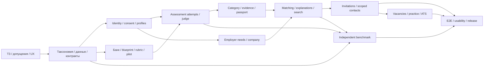

# 5. Полный план разработки

## 5.1. Организация работы и контрольные точки

Объём не ограничен двумя разработчиками. План делится на независимые рабочие контуры: продукт/UX, прикладное ядро, assessment content и judge, matching/NLP, data/evaluation, инфраструктура и QA. Ответственные назначаются по фактическим возможностям; число исполнителей в расчёт scope не заложено.

Единица готовности — работающая возможность с данными, UI, серверными правилами, отказами и проверкой. Файлы-заглушки и документы о будущих функциях не считаются реализацией.

Общие критерии Done для рабочего пакета:

- Поведение соответствует требованиям и типизированному API.
- Данные сохраняются между перезапусками; migration существует.
- Права и критичные негативные сценарии проверены.
- UI имеет normal/loading/empty/error состояния.
- Нет зависимостей от неопубликованных секретов или ручного исправления БД.
- Документация описывает фактическую версию и ограничения.
- Для качества приведены реальные результаты либо честный статус `NOT_MEASURED`.

## 5.2. Зависимости

Критический путь: identity → подтверждённая категория → подборка → приглашение → согласие → раскрытие. Содержание тестов и независимая оценка начинаются одновременно со scaffold, а не после UI.

## 5.3. Рабочие пакеты

### W00 — Продуктовый контракт

Результат: карта R01–R42, user flows, список допущений, термины, пустые/ошибочные состояния и порядок демонстрации. Утвердить разницу declared/confirmed, nullable vacancy_id, no-FSP и contact grants.

Приёмка: из каждого обязательного требования можно перейти к конкретной проверке. Письменные ответы экспертов добавляются как versioned source; изменение контракта имеет rationale и impact.

### W01 — Scaffold и воспроизводимая среда

Создать monorepo, pinned dependencies, Compose, Caddy, PostgreSQL/pgvector, API/web/worker, Keycloak realm и Mailpit. Реализовать bootstrap, migrations, seeds, doctor и health endpoints.

Приёмка: на чистой базе одна документированная команда поднимает core; reload/restart сохраняют данные, повтор seed не дублирует справочники. Windows/WSL и Linux пути проверены. Первоначальная интернет-зависимость перечислена.

### W02 — Identity, consent и ownership

OIDC Code+PKCE, BFF session, email verification, role onboarding, company membership, logout/revocation, CSRF и отдельные согласия. Права применить до заполнения платформы персональными данными.

Приёмка: обе роли проходят настоящий registration flow; другая роль и другой владелец не получают чужие объекты; callback attacks и неподтверждённый email отклоняются. Demo-login не включён в production profile.

### W03 — Taxonomy и seed

Подготовить шесть направлений и четыре грейда, competency mapping, стековые маршруты, skills/aliases/edges. Создать detailed personas, synthetic generator и JSON schemas. Метаданные данных и версия обязательны.

Приёмка: каждой заявленной поддерживаемой категории соответствует reviewed blueprint и достаточное покрытие семейств. Навык со статусом unknown не маскируется под подтверждённый. Нет фиктивного coverage.

### W04 — Candidate profile и PDF

Форма профиля, preferences, privacy, draft PDF import, ручное подтверждение полей с цитатами, собственный стандартизированный PDF. Безопасная employer projection и отдельный export.

Приёмка: кириллица и layout PDF читаемы; contacts не оказываются в закрытом export; неподдерживаемый scan не даёт ложный success; ручная форма позволяет продолжить путь.

### W05 — Assessment content

Создать версионированные blueprints, task families, reference solver, generator constraints и rubrics. Цель максимального релиза — **около 120 reviewed семейств** с явно заявленными областями и уровнями. Количество само по себе не является критерием качества.

Для каждого поддерживаемого competency-slot должны существовать альтернативные семейства, независимые reference checks и содержательные варианты. Новое семейство сначала draft, затем review/pilot, затем active. Одно семейство не получает все грейды только через увеличение числа входных данных.

Приёмка: минимум 100 различных seeds на active family/поддерживаемый level проходят independent correctness checks; публичное условие действительно определяет oracle. Выбор вне supported stack невозможен. Непроверенное семейство не участвует в подтверждении категории.

### W06 — Attempt lifecycle и оценка

Серверные попытки, timer, autosave, восстановление, одна активная попытка, ответы, submissions, grading queue, idempotency и category policy. Result связывается с неизменяемой rubric/blueprint.

Приёмка: category появляется только из успешного принятого результата; FAIL сохраняет старый confirmed grade; часы и cooldown проверены на границах; повтор submit и concurrent tabs не меняют завершённую попытку.

### W07 — Judge и практическая проверка

Выделенный Linux runner, gVisor, gateway, external trusted oracle, ограничения runtime, stop/cancel, очереди и security smoke. Для первой полноценной версии — Python, JS/TS и SQL; дополнительные языки включаются после приёмки своих образов.

Приёмка: submission выполняется действительно, результаты проверяются снаружи sandbox; сеть/host mounts/secrets недоступны, процесс и output ограничены; failure не присваивает грейд. Неподдерживаемое окружение fail-closed и видно в doctor.

### W08 — Evidence и паспорт

Принятые подтверждения, skill evidence, даты, версии, ограничения, practice-only статусы и безопасные projection. Единый интерфейс provenance для тестов и ФСП.

Приёмка: каждая подтверждённая competence имеет разрешённый источник; failed retest не заменяет успешное evidence; self-declared skill виден отдельно; старый результат воспроизводим.

### W09 — ФСП: демонстрационный и будущий контракт

Mock registry с synthetic data, mock identity ownership, linking callback, statuses, sync retry/timeout, source revocation, schema mapping. Реальный Registry Port документируется без выдуманного API.

Приёмка: невозможно присвоить чужой demo FSP ID; кандидат без истории проходит всю платформу; outage отличается от отсутствия истории; demo label виден в UI и export.

### W10 — Employer needs и NLP

Компания, команда, потребность, versions, required/preferred skills, salary/work conditions. Text extractor с цитатами, negative/optional handling, manual confirmation; CPU embeddings отдельным профилем.

Приёмка: «не требуется Kafka» не становится требованием; UI объясняет uncertain fields; нет remote LLM-зависимости основного пути; редактирование need не меняет уже сохранённые формы/условия приглашения.

### W11 — Search и ranking

Category matrix, admission, full-bank filters, skill evidence features, FSP cap, deterministic ranking, graph mapping, semantic assist, explanations и comparison. Saved run сохраняет version/context; refine создаёт дочернюю версию.

Приёмка: relevance объясняется для конкретной need; категория и согласие проверяются до выдачи; сравнение имеет одинаковую основу; изменение фильтра не уничтожает исходную подборку; stale saved results не раскрывают отозванные данные.

### W12 — Invitations и contacts

Create/send/view/accept/decline/withdraw/expire, обязательные условия, terms version, salary validation, company scopes, grants, revoke, clarification и внутренние notifications/SSE.

Приёмка: invitation существует без vacancy; в двух браузерных сессиях видны реальные статусы; контакты открываются только отправителю после явного принятия; grant revoke работает во всех выдачах/exports; no hidden PII в response payload.

### W13 — Публичные вакансии и отклики

Draft/publish/edit/close, salary requirements, каталог кандидата, собственные application statuses, employer pipeline и scoped contacts по отклику.

Приёмка: опубликованная вакансия не существует без зарплаты, candidate имеет полноценную инициативу, application принадлежит конкретной компании; основной обратный путь остаётся первым в кабинете работодателя.

### W14 — Короткая практика

Employer context, reviewed family selection, periodic assignment, voluntary solution, objective result, limited freshness signal, отдельный result type и приглашение автору.

Приёмка: практика не меняет грейд автоматически, субъективный employer score не становится общей сертификацией, отсутствие участия не снимает confirmed category.

### W15 — Anti-fraud и ATS

Spam limits, block/report, quality review, concept employer verification, signed webhook с минимальным payload, demo ATS receiver, retry ledger и dead letters. Правила проверки реальной компании не блокируют обязательный MVP-путь без требования ТЗ.

Приёмка: до принятия ATS export не получает контакты; повтор события не создаёт дубли; webhook проверяет подпись и timestamp. README прямо называет integration демонстрационной, пока нет vendor-specific adapter и реального контракта.

### W16 — Независимые benchmark и pilot

Locked data, labeling rubric, baselines, ablation, retest, leakage experiments, extraction benchmark, добровольцы, usability и environment manifests. Начинается на W03 и продолжается вместе с разработкой.

Приёмка: gold не повторяет formula; отчёт содержит actual measurements, failure cases и intervals; синтетические и человеческие результаты разделены; claims соответствуют данным.

### W17 — Release и документация

OpenAPI/TS-client, ADR, architecture/ERD, rules, FSP/ATS contracts, versions/licenses, privacy, setup, backup/restore, operations, demo script и итоговая DOC/PDF-документация. Production secrets и demo flags отделены.

Приёмка: человек вне процесса запускает стенд по инструкции; обязательный сценарий работает на конкретном commit; все материалы сдачи имеют рабочие ссылки; результаты воспроизводимы и относятся к release version.

## 5.4. Календарь до 11 октября

Даты — календарные контрольные точки МСК, а не оценка доступных человеко-часов. Новый ответ экспертов может изменить конкретную механику, но не должен уничтожить готовый основной путь.

| Дата | Основной результат | Работа остальных контуров | Gate |
|---|---|---|---|
| 7 октября | Контракт продукта, architecture ADR, core scaffold, identity/profile/need skeleton, первый runnable seed | UX обоих кабинетов, taxonomy, первые reviewed families, schema gold и независимая разметка | Core запускается, серверные роли работают, модель declared/confirmed/grant согласована |
| 8 октября | Полный вертикальный путь: опрос → тест → категория → подборка → invitation → accepted contacts | Judge, ФСП mock, PDF, negative tests, первые pilot attempts | Сквозной сценарий действительно проходит между двумя аккаунтами, без ручной правки результата |
| 9 октября | Закончены все обязательные функции, saved search/refine, explanations, comparison и privacy | Расширение reviewed content, вакансии/отклики, CPU NLP, locked benchmark и usability | R01–R28/R34–R40 проверены; unsafe profile не раскрывает контакты |
| 10 октября | Практика, ATS demo, мобильные экраны, anti-spam; candidate/HR polish | Pilot/retest/leakage evaluation, load, isolation/security, doc export | Все реально заявленные дополнительные функции проходят приёмку; bank/explanation errors устранены |
| 11 октября до 12:00 | Release candidate, freeze features | Чистая сборка, restore, повтор критичного E2E на release, проверка данных и versions | Нет blocker дефектов, инструкция воспроизводима |
| 11 октября до 18:00 | Готовый проверяемый комплект: repo, docs, прототип или видео/инструкция | Финальная проверка URLs/access, соответствие submit fields | Материалы готовы к загрузке с запасом |
| 11 октября 18:00–21:00 | Загрузить решение и проверить доступность отправленного | Допустимы исправления blocker при сохранении рабочего релиза | Есть подтверждение сдачи, backup и записанная версия |
| 11 октября 21:00–23:59 | Только резерв на технические проблемы сдачи | Релиз не меняется без необходимости | Официальный крайний срок — 23:59 МСК |

Презентация обязательна для финальной сдачи, но пользователь отложил её в этой задаче. Поэтому она должна быть подготовлена отдельной работой до deadline; без неё технически сильный проект может не выполнить комплект сдачи. Шаблон здесь не изменяется.

Дата промежуточной сдачи не установлена просмотренным PDF: уточнить регламент. Не предполагать, что промежуточная сдача совпадает с одной из наших внутренних точек.

## 5.5. Приоритет при конфликте времени

Scope максимальный, но release должен оставаться пригодным для проверки. Очерёдность внутри незавершённого остатка:

1. Контакты/роли/зарплата/подтверждённая категория/основной inverse flow.
2. Содержательное тестирование и независимая оценка качества.
3. Explanations, no-FSP, работающий локальный запуск и документация.
4. Вакансии/отклики и короткие задачи из списка дополнительных баллов.
5. NLP, comparison, ATS demo, мобильный polish и operator dashboard.
6. Новые роли/языки/infra-компоненты после приёмки основного.

Незавершённая функция не рекламируется как работающая. Скрытые shortcuts, неподтверждённые badges и выдуманные результаты запрещены продуктовым контрактом. Этот порядок определяет последовательность релиза, а не ограничивает амбицию проекта.

## 5.6. После первого дедлайна

Если команда проходит в дальнейшую экспертизу, усиление направлено на эмпирику и качество:

- Расширить pilot по категориям, оценить переносимость форм, переутвердить cut scores и calibration status.
- Проверить генераторы на более сложных классах входов и убрать слабые families.
- Добавить calibrated CAT только там, где хватает данных и соблюдены предпосылки модели.
- Улучшить независимый benchmark новыми потребностями и profiles, не переиспользуя раскрытый test как untouched holdout.
- Провести отдельное проверяемое UX-сравнение времени до релевантного приглашения.
- Подключить реальный ФСП только после договора identity/API/data semantics; сохранить полный путь без ФСП.
- Настроить настоящую ATS integration с выбранным vendor, согласованием contacts и удалением/отзывом.
- Развернуть доступный жюри стенд с isolated runner, российским storage для реальных данных и ограниченными demo accounts.
- Измерить нагрузку на большем наборе, только затем увеличивать число инфраструктурных сервисов.

## 5.7. Риски и решения

| Риск | Как обнаружить | План действия |
|---|---|---|
| Тест измеряет trivia, а не работу | Expert review и практический pilot | Заменить слабые families, отделить claim знаний от профессионального опыта |
| Разные формы сильно отличаются | Counterbalanced pilot/time/score | Ограничить параметры, пересобрать blueprint, suspend families |
| Отсутствуют реальные human observations | Dataset ledger | Назвать результаты simulation/team labels; не заявлять калибровку |
| Feature scope расползается | Gates основного пути не проходят | Завершить P0, включать P1 после приёмки; сохранять maximum backlog |
| User code получает доступ к хосту | Runner security smoke | Изолированный Linux/gVisor; fail-closed при недоступности |
| RAM/CPU не укладываются в локальную машину | doctor и resource report | Ограничить ML/runner concurrency, убрать optional observability из основного запуска |
| FSP связывается с произвольным ID | Ownership tests | Identity-based linking, distinct demo labels, запрет guessed identity |
| Контакты утекают через PDF/SSR/cache | Payload/export/privacy negative tests | Allowlist DTO, отдельный export, no-store и recheck grants |
| Самоописание незаметно повышает категорию | Domain invariants | Категория только из принятой попытки, immutable evidence |
| FSP-бонус подавляет релевантность | Ablation и subgroup review | Cap, specialization context, запрет обхода gates |
| Отсутствует публичный сервер | Release readiness | Полное видео и чистая локальная инструкция как разрешённая ТЗ альтернатива |
| Эксперты меняют трактовку | Source register | Явный impact assessment, versioned policy, миграция только по необходимости |
| Финальная отправка откладывается | Release schedule | Готовый комплект к 18:00 и загрузка до 21:00 |

## 5.8. Release checklist

- [ ] Конкретный repository URL и release commit/tag доступны.
- [ ] Все обязательные требования связаны с фактической приёмкой.
- [ ] Новый кандидат с подтверждённой почтой проходит обязательный путь.
- [ ] Работодатель описывает свою потребность и получает категории/подборку.
- [ ] Invitation без опубликованной вакансии содержит зарплату и контакт компании.
- [ ] Контакты скрыты до разрешения и доступны только получившей его компании.
- [ ] No-FSP и sync-failed различаются; ни один не ломает путь кандидата.
- [ ] Правила теста, cooldown, evidence и matching объясняются из интерфейса.
- [ ] Benchmarks и фактические отчёты относятся к release версии.
- [ ] Fresh install, restart, seed и backup/restore проверены.
- [ ] OpenAPI, versions/licenses, FSP scheme и DOC/PDF-документация готовы.
- [ ] Секреты, частные резюме, материалы организатора и копии стороннего кода не публикуются случайно.
- [ ] Есть доступный prototype URL либо demo video и проверенная инструкция.
- [ ] Презентация подготовлена отдельной работой; слайды 7–11 соответствуют шаблону.
- [ ] Сдача выполнена и её статус проверен до закрытия платформы.
